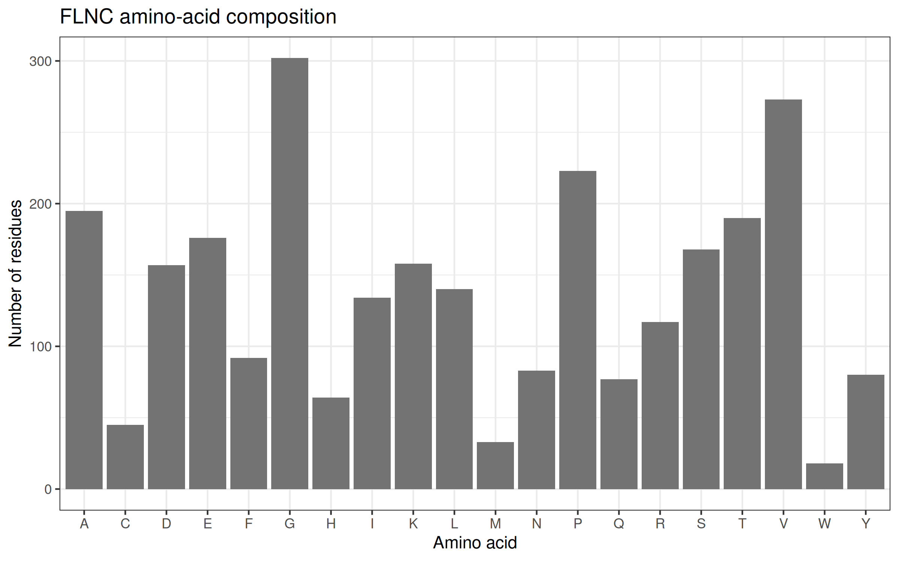
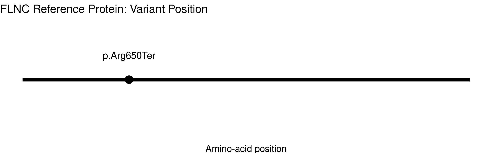

# FLNC: Protein Structure and Mutation Analysis

## Student and Assignment Information

| Item | Details |
|---|---|
| Course | BIO 300 – Cell and Molecular Biology |
| Student | Klea Mae G. Estrellanes |
| Student number | 202400728 |
| Gene symbol | FLNC |
| Gene name | Filamin C |
| Organism | *Homo sapiens* (human) |
| NCBI Gene ID | 2318 |
| Assigned transcript | NM_001458.5 |
| ClinVar Variation ID | 421215 |
| Nucleotide variant | NM_001458.5:c.1948C>T |
| Protein consequence | NP_001449.3:p.Arg650Ter |
| Reference protein length | 2,725 amino acids |
| ClinVar record checked | October 28, 2026 |

## 1. Project Overview

This project investigates the human FLNC gene and the potential functional consequences of the variant NM_001458.5:c.1948C>T (p.Arg650Ter). The analysis uses public biological databases, an amino-acid sequence retrieved from NCBI, an amino-acid composition analysis, and a visualization of the variant’s position in the protein.

The main purpose is to connect the variant’s molecular consequence to the biological function of filamin C and to discuss how a premature stop codon may affect muscle structure and function.

Research Question

How might the FLNC nonsense variant NM_001458.5:c.1948C>T (p.Arg650Ter), which introduces a premature termination codon at amino-acid position 650, affect filamin C and contribute to muscle-related disease?

## 2. Gene and Protein Background

The FLNC gene encodes filamin C, a cytoskeletal protein expressed predominantly in skeletal and cardiac muscle. Filamin C helps organize the actin cytoskeleton and supports the structural connections that allow muscle cells to withstand mechanical stress during contraction.

Filamin C interacts with other proteins at important structural regions of muscle cells, including the Z-disc and myotendinous junction. These interactions contribute to the organization, stability, and maintenance of muscle fibers.

Because filamin C contributes to muscle-cell structure, damaging variants in FLNC can be associated with different muscle and cardiac phenotypes. The particular outcome depends on factors such as the variant, its molecular effect, the affected protein region, and the biological context.

### Reference Information

| Field | Information |
|---|---|
| Gene symbol | FLNC |
| Gene name | Filamin C |
| NCBI Gene ID | 2318 |
| Reference transcript | NM_001458.5 |
| Reference protein | NP_001449.3 |
| Protein length | 2,725 amino acids |
| Nucleotide change | c.1948C>T |
| Protein change | p.Arg650Ter |
| ClinVar Variation ID | 421215 |

### Database Links

- [NCBI Gene: FLNC](https://www.ncbi.nlm.nih.gov/gene/2318)

- [NCBI Nucleotide: NM_001458.5](https://www.ncbi.nlm.nih.gov/nuccore/NM_001458.5)

- [NCBI Protein: NP_001449.3](https://www.ncbi.nlm.nih.gov/protein/NP_001449.3)

- [NCBI ClinVar: Variation ID 421215](https://www.ncbi.nlm.nih.gov/clinvar/variation/421215/)


## 3. Methods and Reproducible Workflow

The analysis was performed in RStudio/Posit Cloud using the `rentrez` and `ggplot2` packages.

### Procedures

1. Created an R project named `Muscle_Contractility_FLNC` containing `analysis.R` and the `data/`, `results/`, and `figures/` directories.
2. Installed the required packages using `install.packages(c("rentrez", "ggplot2"))` and loaded them using `library(rentrez)` and `library(ggplot2)`.
3. Set the assigned gene symbol (`FLNC`), transcript accession (`NM_001458.5`), ClinVar Variation ID (`421215`), and protein consequence (`p.Arg650Ter`) in the R script.
4. Queried NCBI Gene for the human FLNC record and saved the gene summary as `results/gene_summary.txt`.
5. Retrieved the GenBank record for transcript `NM_001458.5`, extracted its linked RefSeq protein accession, retrieved the protein FASTA sequence, and saved it as `data/FLNC_protein.fasta`.
6. Counted the 20 standard amino acids in the retrieved sequence and saved the frequency table as `results/amino_acid_composition.csv`.
7. Generated an amino-acid composition bar chart saved as `figures/01_amino_acid_composition.png`.
8. Generated a linear protein-position plot marking residue 650, saved as `figures/02_variant_position.png`.
9. Examined the assigned ClinVar record and recorded the reported classification, review status, associated conditions, and evaluation dates.

### Reproducing the Analysis

To reproduce the analysis in a fresh R session:

1. Install R and RStudio, or use a compatible Posit Cloud environment.
2. Install the required packages:

   ```r
   install.packages(c("rentrez", "ggplot2"))
   ```

3. Open the project directory in RStudio.
4. Run `analysis.R` from the beginning.
5. Confirm that the expected files are generated and that the results match the values reported in this README.

The workflow retrieves records from NCBI at runtime. Database records and clinical classifications may change, and network access or NCBI rate limits may affect retrieval. The assigned transcript and variant should not be substituted without instructor approval.

## 4. NCBI Gene and Protein Results

| Item | Result |
|---|---|
| Gene symbol | FLNC |
| NCBI Gene ID | 2318 |
| Transcript accession | NM_001458.5 |
| Protein accession retrieved by R | NP_001449.3 |
| Protein length counted from FASTA | 2,725 amino acids |
| FASTA file | `FLNC_protein.fasta` |
| Gene summary | `gene_summary.txt` |
| Protein accession record | `protein_accession.txt` |
| Amino-acid composition CSV | `amino_acid_composition.csv` |
| Amino-acid composition figure | `01_amino_acid_composition.png` |
| Variant position figure | `02_variant_position.jpg` |

The protein accession was extracted from the GenBank record associated with the assigned transcript. The protein length was calculated by counting the amino-acid residues in the retrieved FASTA sequence.

These results identify the reference sequence used for the analysis. They do not establish the length or abundance of a protein produced from the variant allele.

## 5. Amino-Acid Composition

The R script counted the occurrences of the 20 standard amino acids in the retrieved 2,725-residue FLNC reference protein.

The three most abundant amino acids were:

| Rank | Amino acid | One-letter code | Count |
|---:|---|:---:|---:|
| 1 | Glycine | G | 302 |
| 2 | Valine | V | 273 |
| 3 | Proline | P | 223 |

### Figure 1. Amino-Acid Composition of the FLNC Reference Protein

.

**Interpretation:** Glycine, valine, and proline were the three most frequent residues in the analyzed reference sequence. These counts describe the primary-sequence composition. They cannot independently establish the protein's three-dimensional structure, specific molecular interactions, pathogenicity, or the functional effect of p.Arg650Ter.

## 6. Assigned ClinVar Variant

The assigned variant is **NM_001458.5:c.1948C>T**, corresponding to **NP_001449.3:p.Arg650Ter**.

This is a **nonsense variant** because the nucleotide substitution changes the codon for arginine at amino-acid position 650 into a premature termination codon.

### Reported ClinVar Findings

The ClinVar record checked on October 28, 2026, was reported to display an aggregate germline classification of **Pathogenic**, with four submissions contributing to that classification. The record was reported to show a last-evaluated date of September 8, 2025.

The associated condition records include muscle and cardiovascular phenotypes. The specific condition-level interpretations should be examined separately from the aggregate variant-level classification.

### Variant Links

- [ClinVar Variation ID 421215](https://www.ncbi.nlm.nih.gov/clinvar/variation/421215/)
- [Assigned transcript: NM_001458.5](https://www.ncbi.nlm.nih.gov/nuccore/NM_001458.5)
- [Reference protein: NP_001449.3](https://www.ncbi.nlm.nih.gov/protein/NP_001449.3)

**Evidence limitation:** ClinVar is a clinical variant-interpretation database. Its classification summarizes submitted evidence; it is not, by itself, direct experimental proof of the molecular effect in a particular cell type. The number of submissions contributing to a classification is not the same as the review-status star level.

## 7. Protein-Position Figure

### Figure 2. Position of p.Arg650Ter in the FLNC Reference Protein



The figure represents the 2,725-amino-acid reference protein as a linear sequence and marks the assigned variant at position 650.

The marker identifies the position associated with the protein consequence in the reference sequence. It does not show the experimentally determined length of an altered protein or prove that a shortened protein is produced.

## 8. Molecular Mechanism, Interpretation, and Limitations

The assigned variant introduces a premature termination codon at amino-acid position 650. This type of variant can affect protein production through more than one possible mechanism.

One possibility is **nonsense-mediated mRNA decay (NMD)**, a cellular RNA-surveillance pathway that recognizes and degrades certain transcripts containing premature termination codons. Alternatively, some transcripts may escape degradation and produce an abnormal truncated polypeptide.

Whether NMD occurs depends partly on the transcript structure and the position of the premature termination codon relative to exon–exon junctions. The protein-position plot alone cannot distinguish between these outcomes.

### Proposed Mechanistic Pathway

**FLNC c.1948C>T → premature termination codon → possible transcript degradation and/or abnormal protein production → potential loss of filamin C function → possible impairment of muscle-cell structural integrity.**

The reported pathogenic classification in ClinVar supports the clinical relevance of the variant. However, this project did not measure FLNC RNA abundance, filamin C protein abundance, protein size, cellular localization, or muscle function. Therefore, NMD, protein truncation, and a specific cellular defect have not been experimentally demonstrated by this computational analysis.

### Proposed Validation Experiments

A follow-up study could compare variant-bearing cells with appropriately matched control cells.

- **RNA analysis:** Measure FLNC transcript abundance and, where appropriate, compare transcript levels with and without inhibition of NMD.
- **Western blotting:** Assess filamin C abundance and apparent molecular size using validated antibodies.
- **Immunofluorescence microscopy:** Examine filamin C localization and muscle-cell structural organization.
- **Functional assessment:** If a suitable muscle-cell model is available, measure a relevant structural or contractile phenotype.

Appropriate controls, biological replicates, and a validated model system would be required. These experiments could help distinguish a predicted mechanism from an experimentally observed molecular consequence.

## 9. Discussion

The FLNC gene encodes filamin C, an actin-binding cytoskeletal protein that contributes to muscle-cell organization and structural integrity. The assigned variant is NM_001458.5:c.1948C>T, corresponding to p.Arg650Ter in RefSeq protein NP_001449.3. This is a nonsense variant because the nucleotide substitution introduces a premature termination codon at amino-acid position 650. The R workflow retrieved the transcript-linked reference protein and counted 2,725 amino-acid residues.

The amino-acid composition analysis identified glycine as the most frequent residue (302), followed by valine (273) and proline (223). These results describe the primary sequence. They do not independently establish protein structure, molecular interactions, pathogenicity, or the functional effect of the assigned variant.

The ClinVar record checked on October 28, 2026, was reported to display an aggregate germline classification of Pathogenic, with four submissions contributing to the classification. This represents a clinical database interpretation and should be distinguished from direct experimental evidence of the molecular mechanism. The current classification, review status, condition records, and supporting submissions should be verified before submission.

The premature termination codon may cause nonsense-mediated mRNA decay or allow the production of an abnormal truncated protein. If normal filamin C abundance or function is reduced, muscle-cell structural integrity could be affected. However, neither the amino-acid composition chart nor the linear position plot establishes which molecular outcome occurs. This project did not directly measure RNA abundance, protein abundance, protein localization, or muscle function.

Follow-up experiments could quantify FLNC RNA, assess filamin C abundance and apparent size by Western blotting, and examine protein localization using immunofluorescence microscopy. A suitable muscle-cell model could also be used to test structural or contractile consequences. Appropriate controls and biological replicates would be essential. Overall, the analysis combines reference-sequence analysis with clinical variant annotation to formulate a mechanistic hypothesis. Experimental validation is still required to determine the variant's molecular consequences in a defined biological context.


## 10. Answers to the Required Questions

### 1. What does FLNC encode, and how does the protein contribute to muscle function?

FLNC encodes filamin C, an actin-binding cytoskeletal protein that helps maintain muscle-cell structural integrity. It connects components of the actin cytoskeleton with other structural and signaling proteins, supporting muscle organization during contraction and relaxation.

### 2. What was the exact protein accession and length retrieved with R?

The retrieved RefSeq protein accession was NP_001449.3, associated with transcript NM_001458.5. The R script counted 2,725 amino acids in the retrieved reference protein sequence.

### 3. What did the amino-acid composition chart show, and what can it not tell you?

The three most abundant amino acids were glycine (302 residues), valine (273 residues), and proline (223 residues). The chart describes amino-acid frequency but cannot independently establish protein structure, molecular interactions, pathogenicity, or the functional effect of the variant.

### 4. What is the assigned ClinVar variant, and what is its classification and evidence strength?

The assigned variant is NM_001458.5:c.1948C>T (p.Arg650Ter), ClinVar Variation ID 421215. The record was reported as Pathogenic, with multiple submitters contributing to the aggregate classification. The current classification, review status, and supporting evidence should be verified directly on ClinVar before submission. A clinical classification is not equivalent to direct experimental confirmation of the molecular mechanism.

### 5. What is the scientifically supported mechanism linking the variant to muscle function, and what remains uncertain?

The variant introduces a premature termination codon at residue 650. This may cause nonsense-mediated mRNA decay or allow production of an abnormal truncated protein. Reduced filamin C abundance or function could compromise muscle-cell structural integrity. However, this project did not experimentally determine whether the transcript is degraded, whether a truncated protein is produced, or what cellular effects occur.

### 6. What additional experiment would help test the proposed mechanism?

RNA analysis could measure FLNC transcript abundance and investigate possible nonsense-mediated mRNA decay. Western blotting could assess filamin C abundance and apparent molecular size, while immunofluorescence microscopy could examine its cellular localization. Appropriate controls and biological replicates would be required.
## 11. Limitations

1. **Sequence\-based analysis:** The analysis examines sequence information and amino\-acid frequencies, not protein function in living cells\.
2. **Protein expression:** The project does not establish whether a shortened filamin C protein is produced\.
3. **Nonsense\-mediated decay:** NMD is a possible mechanism, but transcript degradation was not directly measured\.
4. **Clinical interpretation:** ClinVar provides a clinical classification based on submitted evidence; this project does not independently validate that classification\.
5. **Experimental validation:** No functional assay was performed to directly measure the variant’s effect on muscle\-cell structure or function\.
6. **Reproducibility:** Results depend on the exact input sequence, R code, package versions, and output files\. These should be checked when reproducing the analysis\.

## 12. References and Database Links

1. National Center for Biotechnology Information (NCBI). **FLNC, Gene ID 2318.**  
   https://www.ncbi.nlm.nih.gov/gene/2318

2. NCBI Nucleotide / RefSeq. **FLNC transcript NM_001458.5.**  
   https://www.ncbi.nlm.nih.gov/nuccore/NM_001458.5

3. NCBI Protein / RefSeq. **Filamin C, NP_001449.3.**  
   https://www.ncbi.nlm.nih.gov/protein/NP_001449.3

4. NCBI ClinVar. **FLNC variant, Variation ID 421215.**  
   https://www.ncbi.nlm.nih.gov/clinvar/variation/421215/

5. Ortiz-Genga, M. F., et al. (2016). *Truncating FLNC Mutations Are Associated With High-Risk Dilated and Arrhythmogenic Cardiomyopathies.* Journal of the American College of Cardiology.  
   https://pubmed.ncbi.nlm.nih.gov/27908349/

6. rentrez documentation. **Accessing NCBI databases from R.**  
   https://docs.ropensci.org/rentrez/

7. ggplot2 documentation. **Data visualization in R.**  
   https://ggplot2.tidyverse.org/

   Database access date for this revision: October 28, 2026.

